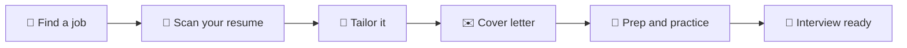

<div align="center">


# Jobaton OSS

### Your job search, on your machine, powered by your own AI.

Find jobs, beat the ATS, write cover letters and prep for interviews.<br/>
Self-hosted, open source, and private by default.

[](LICENSE)
[](https://hub.docker.com/r/nepica/jobaton)
[](https://github.com/nepica-llc/jobaton-oss/tags)
[](#-pick-your-ai)

[Quick start](#-quick-start) · [Features](#-what-you-can-do) · [AI providers](#-pick-your-ai) · [Privacy](#-privacy-and-security) · [Contributing](#-contributing)

</div>

---

## 💡 Why Jobaton?

Job hunting means juggling a dozen tabs, a pile of resume versions and a spreadsheet you stopped updating in week two. Jobaton puts the whole search in one place and uses AI where it actually helps: matching your resume to a role, writing the first draft and getting you ready for the interview.

- 🔒 **Private.** Everything is stored in a local SQLite database. No accounts, no cloud, no tracking.
- 🔑 **Your AI, your bill.** Plug in a key from OpenAI, Anthropic, Google or Mistral. Nothing is routed through us.
- 🐳 **One command.** `docker compose up` and you're running.

## ✨ What you can do

| | Feature | What it does |
|---|---|---|
| 🔎 | **Job search** | Search Indeed, LinkedIn and Glassdoor from one box and save the roles you like |
| 📄 | **Resume builder** | Upload a PDF or build one from scratch, with AI suggestions |
| 🎯 | **ATS scanner** | Score your resume against any job description and see what's missing |
| ✉️ | **Cover letters** | Generate a tailored cover letter for a specific role in seconds |
| 🧭 | **Job prep** | Get a study guide and likely interview questions for each saved job |
| 🎤 | **Interview practice** | AI-driven questions and mock sessions |
| 📊 | **Dashboard** | See your saved jobs, resumes and progress at a glance |

### How it fits together



## 🚀 Quick start

**Recommended: Docker Compose** (includes the job search service)

```bash
git clone https://github.com/nepica-llc/jobaton-oss.git
cd jobaton-oss
docker compose up --build
```

Open **http://localhost:3050**, go to **Settings**, add your AI key, and you're done.

**Just want to try it? Single container from Docker Hub**

```bash
docker run -d -p 127.0.0.1:3050:3001 -v jobaton_data:/app/data nepica/jobaton
```

Everything works except **Job search**, which needs the `jobspy` service that Docker Compose starts for you.

> **Requirements:** Docker (with Compose) and an API key from one of the supported AI providers.

## 🤖 Pick your AI

Add a key in **Settings** and choose which provider is active. You can also set keys through environment variables.

| Provider | Default model | Environment variable |
|---|---|---|
| OpenAI | `gpt-4o-mini` (changeable in Settings) | `OPENAI_API_KEY` |
| Anthropic | `claude-sonnet-4-20250514` | `ANTHROPIC_API_KEY` |
| Google AI | `gemini-2.0-flash` | `GOOGLE_AI_KEY` |
| Mistral | `mistral-large-latest` | `MISTRAL_API_KEY` |

## ⚙️ Configuration

Copy `.env.example` to `.env` to change the defaults.

| Variable | Default | Purpose |
|---|---|---|
| `API_PORT` | `3001` | Port the app listens on |
| `HOST` | `127.0.0.1` | Bind address (the Docker image uses `0.0.0.0` inside the container) |
| `DATA_DIR` | `./data` | Where your local database lives |
| `CORS_ORIGIN` | none | Comma separated origins allowed to call the API cross-origin |
| `JOBSPY_URL` | set by Compose | Address of the job search service |

## 🔐 Privacy and security

Jobaton OSS has **no login**. It's designed to run on your own computer with your own AI key, so:

- The commands above publish it on `127.0.0.1` only, so it's reachable from your machine and nowhere else.
- Cross-origin requests are blocked unless you set `CORS_ORIGIN`.
- Your resumes and settings stay in the `jobaton_data` volume. Your AI key only goes to the provider you picked.

Want to reach it from another device? Put it behind a reverse proxy that adds authentication first. Don't expose it to a network as is.

## 🛠️ Development

```bash
pnpm install   # uses pnpm 9
pnpm dev       # API + web app with hot reload
```

```
jobaton-oss/
├── api/                 Express API: AI proxy and SQLite storage
├── web/                 React app (Vite + Tailwind CSS)
├── jobspy/              Python job search service (FastAPI + python-jobspy)
├── Dockerfile           Multi-stage build: one container serves API and web app
└── docker-compose.yml   App + job search service
```

**Built with** React 18 · Vite · Tailwind CSS · Express · Node.js 22 · SQLite (better-sqlite3) · FastAPI · Docker

## 🤝 Contributing

Bug reports, ideas and pull requests are all welcome.

1. Open an [issue](https://github.com/nepica-llc/jobaton-oss/issues) to describe the bug or idea
2. Fork the repo and create a branch
3. Run `pnpm install && pnpm dev` and make your change
4. Open a pull request

## ⭐ Jobaton Pro

Love the OSS version but want more? [**Jobaton Pro**](https://jobaton.com) adds cloud sync, unlimited AI credits, mock interviews, sprint training and mentorship for $9.99/month.

## 📜 License

[MIT](LICENSE). Free to use, modify and share.

<div align="center">
<br/>
<br/>
<sub>Made for job seekers who'd rather be preparing than tab-juggling.</sub>
</div>
